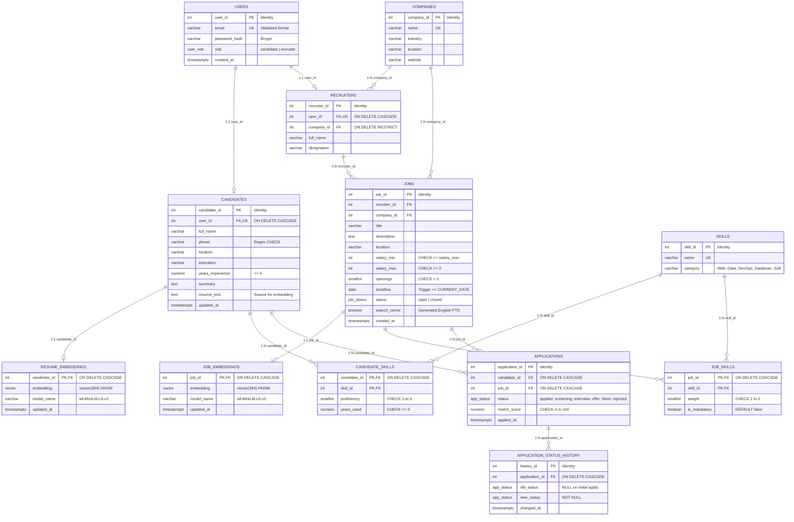

# CareerLens: Entity-Relationship (ER) Diagram & Schema Documentation

## 1. Overview
CareerLens uses a relational PostgreSQL 16 schema augmented with `pgvector` for high-dimensional vector embeddings. The schema is normalized into Third Normal Form (3NF), resolving many-to-many relationships through junction tables and guaranteeing data integrity at the database engine level.

## 2. Mermaid Entity-Relationship Diagram

## 3. Relationships & Cardinalities Summary

| Parent Entity | Child Entity | Cardinality | Implementation & Foreign Key Rules |
|:---|:---|:---:|:---|
| `users` | `candidates` | 1 : 1 | `candidates.user_id` (UNIQUE, NOT NULL, `ON DELETE CASCADE`) |
| `users` | `recruiters` | 1 : 1 | `recruiters.user_id` (UNIQUE, NOT NULL, `ON DELETE CASCADE`) |
| `companies` | `recruiters` | 1 : N | `recruiters.company_id` (NOT NULL, `ON DELETE RESTRICT`) |
| `companies` | `jobs` | 1 : N | `jobs.company_id` (NOT NULL) |
| `recruiters` | `jobs` | 1 : N | `jobs.recruiter_id` (NOT NULL) |
| `candidates` | `candidate_skills` | 1 : N | `candidate_skills.candidate_id` (`ON DELETE CASCADE`, Composite PK) |
| `skills` | `candidate_skills` | 1 : N | `candidate_skills.skill_id` (Composite PK) |
| `jobs` | `job_skills` | 1 : N | `job_skills.job_id` (`ON DELETE CASCADE`, Composite PK) |
| `skills` | `job_skills` | 1 : N | `job_skills.skill_id` (Composite PK) |
| `candidates` | `applications` | 1 : N | `applications.candidate_id` (`ON DELETE CASCADE`) |
| `jobs` | `applications` | 1 : N | `applications.job_id` (`ON DELETE CASCADE`, UNIQUE with `candidate_id`) |
| `applications` | `application_status_history` | 1 : N | `application_status_history.application_id` (`ON DELETE CASCADE`) |
| `candidates` | `resume_embeddings` | 1 : 1 | `resume_embeddings.candidate_id` (PK is FK, `ON DELETE CASCADE`) |
| `jobs` | `job_embeddings` | 1 : 1 | `job_embeddings.job_id` (PK is FK, `ON DELETE CASCADE`) |
